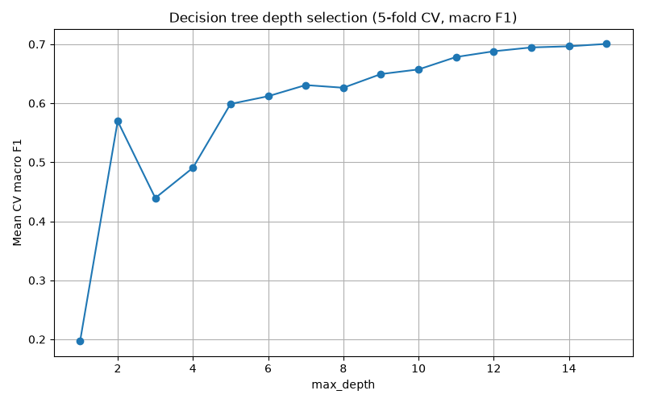
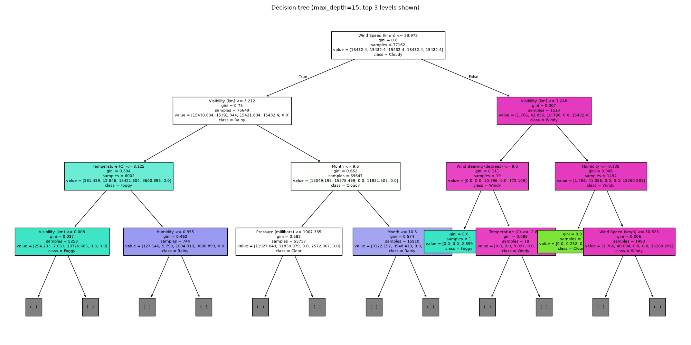
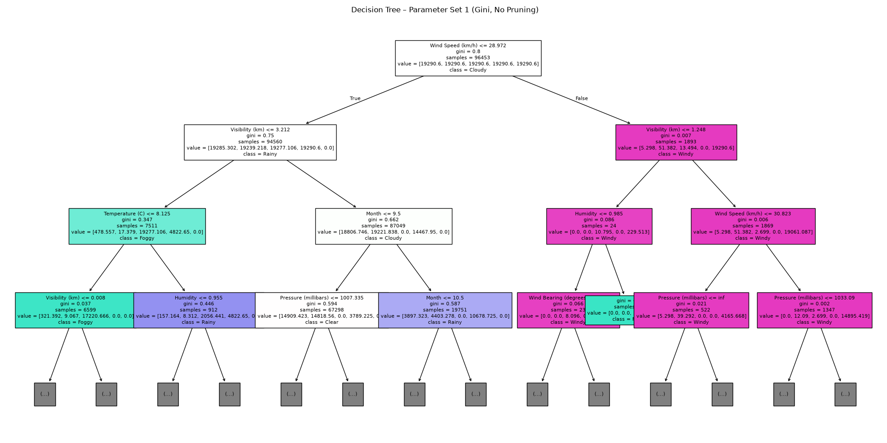
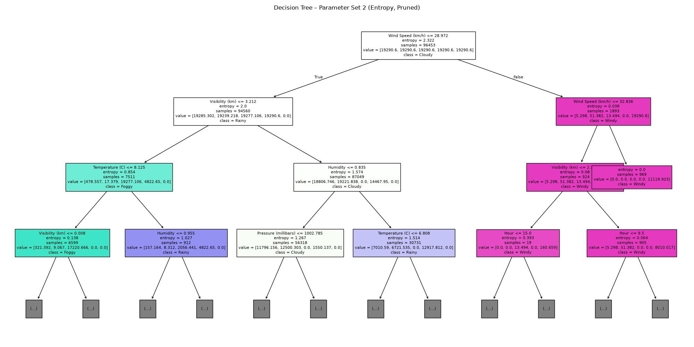

# decision_tree_classification-weather-

Weather type prediction using decision trees (scikit-learn) | Data mining exercise

## What it does

`main.py` downloads the [Weather History dataset](https://www.kaggle.com/datasets/muthuj7/weather-dataset)
from Kaggle and predicts the hourly weather summary, grouped into 5 classes
(Clear, Cloudy, Foggy, Rainy, Windy) using the following predictive parameters:

- **Temperature** (°C)
- **Humidity** (0-1)
- **Wind speed** (km/h)
- **Wind bearing** (degrees)
- **Visibility** (km)
- **Pressure** (millibars; readings of 0 treated as missing)
- **Hour** of the day (extracted from the timestamp)
- **Month** (extracted from the timestamp)
- **Precipitation type** (rain / snow / none, one-hot encoded)

## Methodology

### Preprocessing

- **Time features:** Extracted `Hour` and `Month` from the date, since weather depends on the time of day and the season.
- **Missing pressure:** Pressure readings of 0 were treated as missing values.
- **Dropped columns:** `Daily Summary` (leaks the target), `Apparent Temperature (C)` (adds nothing beyond temperature) and `Loud Cover` (all zeros).

### Target Grouping

The original `Summary` column contains many very specific labels (e.g. "Breezy and Overcast"). These were generalised into 5 categories (Rainy, Windy, Foggy, Cloudy and Clear), which are descriptive enough to be meaningful and still predictable from the weather measurements.

Labels that mention several conditions were assigned to the rarer, more specific one, using the priority Rainy > Windy > Foggy > Cloudy > Clear.

| Class | Assigned when the label contains |
|---|---|
| Rainy | Rain, Drizzle |
| Windy | Breezy, Windy |
| Foggy | Foggy |
| Cloudy | Cloudy, Overcast |
| Clear | Anything else (Clear, Dry and their combinations) |

For example, "Breezy and Overcast" becomes **Windy**, because Windy ranks above Cloudy.

### Class Imbalance

The classes are very imbalanced: most hours are Cloudy, while classes like Windy (about 1.7% of hours) and Rainy (about 0.1%) are rare. A model that always predicts Cloudy would therefore score a high accuracy without being actually able to learn to recognise patterns. Two measures were used to deal with this:

- **Class weights:** The trees were trained with `class_weight="balanced"`, so penalisation is based on rarity. Classes that are more rare have heavier penalisation.
- **Macro F1 for model selection:** Models were chosen by macro F1, which is the average of F1 score of the 5 individual classes so that every class counts equally. Accuracy is still reported, but only as a secondary measure.

### Model Selection

- **20% stratified hold-out test set:** The model is trained on 80% of the data and then makes predictions on the remaining 20%, which it has never seen. Stratified means every class keeps the same share in both training and testing. The test set is not used at all during model selection, so the performance is evaluated with more honesty.
- **5-fold cross-validation over `max_depth` (1-15):** The training data is split into 5 parts, and each part takes a turn as the validation set while the tree is trained on the other 4. This is repeated for every depth from 1 to 15 and scored by macro F1. This is meant to stop the tree from growing too deep, because an overly deep tree memorises the training data and does worse on unseen data (overfitting problem). Here the best score came at depth 15, the deepest value tried, so within this range the search did not need to limit depth.
- **Grid search over `max_depth`, `min_samples_leaf` and `ccp_alpha`:** Every combination of these parameters is evaluated repeatedly with 5-fold CV, and the combination with the best macro F1 is chosen. This finds the best model after many evaluations, and it also tests pruning (`ccp_alpha`) and leaf size, which the depth search alone does not.

### Parameter Set Comparison

Two decision tree setups were compared to see how the split rule and pruning change the results:

| | Criterion | `min_samples_leaf` | `ccp_alpha` | Description |
|---|---|---|---|---|
| **Set 1** | Gini | 1 | 0.0 | No pruning |
| **Set 2** | Entropy | 5 | 0.0001 | Lightly pruned (0.0001, one of the values tried in the grid search) |

Both sets used `class_weight="balanced"` and were tested in two ways:

- **K-fold cross-validation** with 5 and 10 folds.
- **Random train/test splits** (70/30 and 80/20), each done 10 times.

For each test, the average and standard deviation of accuracy and macro F1 were recorded. The standard deviation shows whether a gap between the two sets is real or just chance. All results are in `DecisionTree_Comparison.xlsx`.

This comparison is a separate experiment from the model selection above: its cross-validation and splits run on the whole dataset, not only the 80% training set.

## Results

Majority-class baseline accuracy: **0.7940**

### Model selection

- Best `max_depth` (5-fold CV): **15**
- Test accuracy / macro F1: **0.7758** / **0.6778**
- Best grid search parameters: **{'ccp_alpha': 0.0, 'max_depth': None, 'min_samples_leaf': 1}**
- Grid search test accuracy / macro F1: **0.8655** / **0.7442**

### Parameter set comparison

| Validation Method   | Parameter Set   | Criterion   | k value / split %   |   Accuracy |   Accuracy Std Dev |   Macro F1 |   Macro F1 Std Dev |
|:--------------------|:----------------|:------------|:--------------------|-----------:|-------------------:|-----------:|-------------------:|
| K-Fold              | Set1            | gini        | 5                   |     0.8665 |             0.003  |     0.7493 |             0.0147 |
| K-Fold              | Set2            | entropy     | 5                   |     0.7286 |             0.0022 |     0.7207 |             0.0019 |
| K-Fold              | Set1            | gini        | 10                  |     0.8693 |             0.0043 |     0.7486 |             0.0304 |
| K-Fold              | Set2            | entropy     | 10                  |     0.7232 |             0.0115 |     0.7154 |             0.021  |
| Train/Test          | Set1            | gini        | 70/30               |     0.8662 |             0.0019 |     0.7372 |             0.0175 |
| Train/Test          | Set2            | entropy     | 70/30               |     0.7238 |             0.0069 |     0.7072 |             0.009  |
| Train/Test          | Set1            | gini        | 80/20               |     0.8694 |             0.0024 |     0.7493 |             0.0249 |
| Train/Test          | Set2            | entropy     | 80/20               |     0.7272 |             0.0078 |     0.7145 |             0.0114 |

### Charts








## Discussion 

- **Set 1 (Gini, unpruned) did better than Set 2 (entropy, pruned).** It had higher accuracy (about 0.87 vs. 0.72-0.73) and a better macro F1 (0.74-0.75 vs. 0.71-0.72) in every validation setup. This means the unpruned Gini tree is better overall and also at recognising all five classes, including the rare ones. The accuracy gap is much bigger than the standard deviations (at most 0.012), so it is a real difference and not just chance. The macro F1 gap is smaller, so it is less certain, but Set 1 still came out ahead every time.
- **The data needs a complex tree.** The grid search chose no pruning, no depth limit and `min_samples_leaf` = 1, which agrees with Set 1 winning. Set 2's pruning and larger leaf size lowered both accuracy and macro F1. The depth search picked 15, the deepest value tried, so its range was probably too narrow.
- **Baseline:** Always predicting the most common class gives 0.794 accuracy. Set 1 and the grid search model (0.866) beat this. Set 2 (about 0.72) and the depth-15 model (0.776) fall below it in accuracy. This is because `class_weight="balanced"` gives up some accuracy on the common class to detect the rare ones better, which is why macro F1 is the fairer measure here.
- **Limitations:** Neighbouring hours are very similar, so a random split can put almost identical hours in both training and testing. This may make the scores look better than they are and favours deep trees that memorise. Set 2 also differs from Set 1 in three ways at once (criterion, leaf size and pruning), so the results can't show which one caused the drop.Rare classes are the hardest to predict
  
## Running

```bash
python -m venv venv
source venv/bin/activate
pip install -r requirements.txt
python main.py
```
